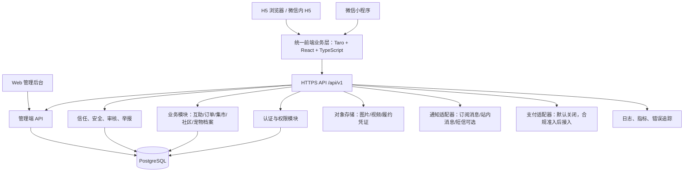

# 宠邻：宠物互助小程序 + H5 产品与技术设计文档

> 文档版本：v1.1（自审修订版）  
> 编写日期：2026-10-10  
> 产品代号：宠邻（暂定名，正式上线前必须完成小程序名称、商标、域名及账号占用核验）  
> 目标交付：可交给 AI 编程 Agent 分阶段实现的产品需求、架构、数据模型、接口和验收规范。

---

## 0. 执行摘要

### 0.1 产品定位

**宠邻是一个以本地宠物互助为入口，连接养宠用户、照料服务、闲置资源、宠物内容与日常健康记录的社区平台。**

首期不尝试一次性实现“宠物版大众点评 + 闲鱼 + 小红书 + 健康管理 + 电商商城”。应优先建立一个真实、可重复发生的本地互助闭环：用户能发起喂养/遛宠/临时照看需求，其他用户可以响应；用户可以发布闲置宠物用品或本地交易信息；双方可以确认安排、留下履约记录、进行评价和举报。

### 0.2 核心产品闭环

1. **互助服务闭环**：发需求 / 发布服务 → 匹配附近用户 → 沟通 → 确认安排 → 履约凭证 → 评价 / 投诉。
2. **本地集市闭环**：发布闲置、赠送、交换或出售 → 搜索附近信息 → 沟通 → 线下交接 / 合规线上支付 → 完成 / 争议处理。
3. **宠物陪伴闭环**：建立宠物档案 → 记录日常、体重、饮食和主观情绪 → 生成趋势 → 分享社区 → 获得有意义的互动和徽章。
4. **信任闭环**：身份与联系方式验证 → 服务/交易历史 → 双向评价 → 举报与申诉 → 风险控制。

### 0.3 推荐决策

| 事项 | 推荐方案 | 原因 |
|---|---|---|
| 品牌名称 | 宠邻（暂定） | 名称能覆盖本地互助、交易和社区，不局限于喂养或健康数据 |
| 前端 | Taro 4 + React + TypeScript | 同一业务代码编译微信小程序和 H5；仓库已有相近的 Taro 项目可参考 |
| 后端 | NestJS + TypeScript，模块化单体 | 前后端同语言，适合小团队和 AI Agent 分阶段交付；领域模块边界清晰 |
| 数据库 | PostgreSQL；位置能力按需启用 PostGIS | 关系型订单/履约数据与社区数据能统一管理；可支持区域筛选与附近查询 |
| 缓存/异步 | MVP 先不强依赖 Redis；必要时增加 Redis + 队列 | 避免早期基础设施过度复杂 |
| 文件 | S3 兼容对象存储 / 云厂商对象存储 | 图片、视频、履约凭证和宠物档案媒体统一存放 |
| 后台 | 独立 Web 管理端 | 审核、举报、订单纠纷、分类、指标和运营必须可管理 |
| 支付 | 默认先记录交易意向，不实现平台余额或资金托管 | 先验证需求和合规准入；支付上线须另行审核主体资格与平台规则 |
| 架构 | 模块化单体，不拆微服务 | 早期业务变化频繁、团队规模未知，先保证可理解、可测试、可部署 |

### 0.4 MVP 明确不做

- 不建设虚拟钱包、用户余额、保证金池或自建资金托管。
- 不做复杂抽佣、自动分账和多级推广佣金。
- 不把“宠物情绪”包装成临床心理诊断，不给出医疗诊断。
- 不以未经验证的 AI 计算替代兽医建议、宠粮包装建议或宠物个体化喂养方案。
- 不在未取得用户明确授权的情况下公开精确家庭地址、手机号或上门时间。
- 不在首期引入微服务、Kafka、独立搜索集群和过多第三方 SDK。

### 0.5 v1.0 自审结论与 v1.1 修订重点

本版已对 v1.0 做了业务一致性复核。v1.0 可作为产品讨论稿，但还不足以不经审查就要求 Agent 直接生成生产级系统。主要问题及本版修正如下：

| 自审发现 | 风险 | v1.1 修订方式 |
|---|---|---|
| 服务发布状态与订单履约状态混用 | 同一需求有多个服务者响应时会产生冲突，状态无法表达 | 将需求/服务公告、服务申请、订单拆成独立状态机 |
| 缺少服务申请、可用时间、状态历史、会话等数据实体 | API 无法闭环，容易把申请直接写成订单 | 补充关键表、状态记录与 API 契约要求 |
| 位置只有区域码，却要求按距离和服务半径搜索 | 无法正确计算距离，也可能诱导开发者暴露精确坐标 | 明确区分公开区域与私密坐标，附近排序作为可选能力分阶段做 |
| 部分 API、表结构和状态转换互相对不上 | Agent 可能各自猜测业务 | 增加接口行为约束、幂等规则、并发与状态校验要求 |
| “开源项目可复用”的口径容易被过度理解 | README、依赖、图片和许可证可能不一致 | 将仓库定位为候选参考；无明确许可证的代码不得直接并入商业产品 |
| 合规假设没有明确地域前提 | 国内外用户、支付、隐私与平台规则不同 | 本方案明确以中国大陆微信小程序 + H5 为基线，其他地区另行评审 |
| 精确地址没有明确的持久化与授权实体 | 开发时可能把地址塞进普通订单 JSON/日志，造成泄露 | 新增订单私密履约信息、私密位置与敏感字段访问审计模型 |
| 举报与订单纠纷混为一个流程 | 无法支持订单证据、协商、裁定和申诉的完整生命周期 | 新增 disputes/dispute_events，并区分内容举报与交易纠纷 |

**实施边界：** 本文是产品、架构和实现验收基线，不等于已完成法律意见、代码安全审计或逐字段 OpenAPI/SQL DDL。Agent 开工后必须把本文进一步落成 OpenAPI 文档、数据库迁移、权限矩阵和自动化测试；若发现冲突，以本文中的状态机、权限和安全约束为准，并先记录决策，不得自行猜测。

### 0.6 地域与合规假设

本方案默认首期面向**中国大陆**用户，使用微信小程序和移动 H5，部署、数据存储和运营安排按实际主体、服务地区与平台规则复核。若首期实际运营地是新加坡或其他地区，应重新评审个人信息保护、支付、税务、用户生成内容、宠物照料服务和消费者保护要求，不能直接沿用本方案中的中国大陆假设。本文不构成法律意见。

---

## 1. 品牌与命名

### 1.1 名称候选

| 名称 | 品牌联想 | 适合的产品策略 | 风险/限制 |
|---|---|---|---|
| **宠邻**（首选） | 邻里、互助、可信、附近 | 本地照料、线下交易、服务评价、社区和健康管理 | “宠邻”是否可注册、是否与现有品牌近似尚待核验 |
| 爪友圈 | 养宠社交、社区、兴趣关系 | 强社区、动态、排行榜、宠物社交 | 对本地服务和交易的直接表达略弱 |
| 宠伴家 | 陪伴、宠物档案、日常健康 | 宠物生命周期管理、情绪与健康记录 | “家”类名称较常见，独特性需核验 |
| 爪爪帮 | 帮忙、互助、轻量、亲切 | 临时喂养、遛宠、邻里帮忙 | 更像工具名，长期电商/内容品牌感稍弱 |
| 宠友集 | 用品集合、用户集合、社区 | 集市、内容和商品推广 | 对邻里互助的差异化不明显 |
| 萌宠邻里 | 直接、易理解、友好 | 面向大众的本地宠物服务 | 名称较长，品牌独特性需核验 |

### 1.2 推荐品牌表达

- 产品名：**宠邻**
- 口号：**邻里互助，让每一份爱宠有回应。**
- 品牌关键词：可信、友好、本地、互助、透明、有责任感。
- 英文概念名：PawNeighbor（仅作为设计占位名，不代表域名或商标可用）。
- 品牌不应只使用猫狗形象：视觉系统应支持猫、狗、兔、鸟及其他常见伴侣动物。

### 1.3 上线前名称检查清单

1. 在微信公众平台检索小程序名称可用性。
2. 在国家知识产权相关公开渠道核查商标相同/近似情况，重点关注第 9、35、42 类及实际业务涉及类别；具体类别由商标代理或法律顾问确认。
3. 检索主流应用商店、公众号、视频号、社交平台同名账号。
4. 检查 `.com`、`.cn` 等域名和常用社交账号是否可注册。
5. 不因搜索引擎未查到同名就推定可以注册。

---

## 2. 用户、场景与价值

### 2.1 目标用户

- **宠物主人**：出差、加班、短途旅行时需要临时喂养或遛宠；希望找到附近可信的人。
- **互助型养宠用户**：愿意帮助邻居，可能用互换时间、互换服务或象征性费用获得回报。
- **服务提供者**：有照料经验，希望发布服务范围、可用时间、收费方式和履约记录。
- **闲置物品发布者/买家**：处理用不上的围栏、航空箱、玩具、猫砂盆等，或寻找附近可交换物品。
- **社区参与者**：分享养宠日常、经验和宠物成长；参与活动、挑战与榜单。
- **内容/商品合作方**：后期发布宠粮、用品及活动推广内容。

### 2.2 关键用户任务

1. 我需要找人周末上门喂猫，希望先看对方的履约记录，而不仅仅是看头像和价格。
2. 我愿意帮附近用户遛狗，希望控制服务半径、可用时间和接单数量。
3. 我想转让闲置宠物用品，希望能限制同城范围，并安全地约定交接。
4. 我想记录宠物体重、饮食和活动量，但不希望系统把估算数据当成医疗结论。
5. 我发布宠物动态，希望获得互动、认识附近的养宠用户，而不是被广告和刷榜内容淹没。

### 2.3 产品原则

- 先解决高频、明确、可履约的需求，后叠加健康和商业化模块。
- 先建立信任与安全机制，再追求交易规模和排行榜增长。
- 位置服务只展示必要精度；未建立交易关系前不展示上门地址。
- 对新用户提供基本保护，不因没有历史评价就永久沉底。
- 评价应绑定已完成的服务或交易，禁止单纯凭空打分。
- 健康指标必须标注来源、时间和估算范围，不能制造虚假精确度。
- 商业推广与普通社区内容视觉上明确区分。

---

## 3. 产品范围与阶段规划

### 3.1 功能优先级

标记说明：P0 = 上线阻断项；P1 = MVP 必须完成；P2 = 第二阶段；P3 = 后续探索。

| 模块 | 功能 | 优先级 | MVP 口径 |
|---|---|---:|---|
| 账号 | 微信登录、H5 登录入口、用户资料、手机号验证 | P0 | 账号身份与登录身份分离；未登录可浏览公开内容 |
| 宠物档案 | 名称、物种、品种、生日/年龄、体重、绝育状态、注意事项、照片 | P1 | 用户可以管理多只宠物，敏感信息默认私有 |
| 互助服务 | 发布需求、发布服务、附近筛选、详情、预约意向、接单、状态更新 | P0 | 支持喂养、遛宠、临时照看等服务类型 |
| 履约凭证 | 服务前后照片、完成时间、照料备注、异常情况 | P0 | 上传前提示不得拍到无关人员或暴露地址信息 |
| 线下集市 | 闲置转让、赠送、交换、出售、搜索、收藏、举报 | P1 | 支持线下自助交易；平台记录流程，但首期不托管资金 |
| 站内沟通 | 订单/交易相关沟通、系统消息 | P1 | MVP 可先使用受限的订单留言/联系方式授权，不必立即做复杂实时聊天 |
| 评价与信用 | 双向评价、标签、已完成记录、用户信誉摘要 | P0 | 评价只绑定真实完成的交易/服务；提供申诉与反滥用规则 |
| 宠物社区 | 图文动态、评论、点赞、关注、分享、举报 | P1 | 首期支持图文；视频后续按存储和审核能力开放 |
| 内容审核 | 敏感词、图片/文本审核接口、用户举报、人工审核、申诉 | P0 | 上线必须有管理后台和处置记录 |
| 榜单与成长 | 活跃、互助贡献、内容互动、连续记录徽章 | P2 | 首期可做徽章，不做单一总分排名 |
| 健康与情绪 | 体重、饮食、饮水、活动、排便、主观心情日志 | P2 | 作为记录工具，不做疾病诊断 |
| 卡路里/喂养 | 根据宠物信息、宠粮标签和用户设置展示估算 | P3 | 标注估算，允许记录兽医建议值；不自动开具喂养方案 |
| 宠粮与用品推广 | 商品内容、推广标识、优惠活动、跳转链接 | P2 | 商业内容必须明确标识推广或广告，商品信息可追溯 |
| 运营后台 | 用户、帖子、举报、服务、交易、类目、活动、审核、审计日志 | P0 | 需具备权限分级与操作审计 |
| 数据与报表 | 漏斗、履约率、举报率、社区活跃、留存 | P1 | 统计应尽量使用聚合数据，避免暴露个人明细 |

### 3.2 发布策略

- **阶段 0：可行性与规范验证**：验证名称、主体资质、服务类目、H5 域名、隐私说明、对象存储、审核流程。
- **阶段 1：本地互助 MVP**：账号、宠物档案、需求/服务发布、预约意向、履约记录、线下集市、举报审核后台。
- **阶段 2：信任与社区**：评价、关注、帖子、评论、通知、徽章、内容推荐与运营工具。
- **阶段 3：健康陪伴**：体重、饮食、活动、情绪主观记录、趋势图和可导出宠物档案。
- **阶段 4：合规交易与商品推广**：完成必要资质和支付审核后再启用在线支付；商品合作、推广标记和数据统计。

---

## 4. 信息架构与页面清单

### 4.1 底部导航

采用 5 个主入口，符合常见小程序信息架构：

1. **首页**：附近需求、互助入口、热门内容、近期活动、推荐集市。
2. **互助**：找人帮忙、我能帮忙、服务列表、我的服务/需求。
3. **集市**：附近闲置、赠送、交换、出售、筛选和发布。
4. **社区**：推荐、关注、最新、话题、发布动态、活动/榜单入口。
5. **我的**：用户资料、宠物档案、订单/交易、收藏、徽章、隐私、安全和设置。

健康管理不独立占用底部导航，入口放在“我的宠物”卡片中。商品推广初期作为内容/活动模块，不强行占据一级导航。

### 4.2 页面列表

#### 首页
- 首页/城市或服务区域选择
- 互助快捷入口：我要找人帮忙、我可以提供帮助
- 附近服务卡片
- 附近闲置/交换卡片
- 社区精选动态
- 活动挑战与榜单摘要
- 新用户安全提示

#### 互助服务
- 服务/需求列表
- 地区、距离、日期、服务类型、价格方式筛选
- 服务/需求详情
- 发布服务表单
- 发布需求表单
- 可用时间管理
- 预约确认页
- 服务订单详情
- 履约记录页
- 评价/投诉页

#### 集市
- 集市首页
- 分类页
- 搜索结果
- 商品/闲置详情
- 发布闲置/赠送/交换/出售
- 收藏列表
- 交易沟通与交接约定
- 交易状态页
- 举报/纠纷入口

#### 社区
- 推荐、关注、最新动态流
- 帖子详情
- 图片预览
- 评论列表
- 发布/编辑动态
- 话题详情
- 用户主页
- 宠物主页（仅公开字段）
- 徽章/榜单页

#### 我的与宠物
- 用户主页和隐私设置
- 我的宠物列表
- 新建/编辑宠物档案
- 宠物健康日志
- 体重趋势
- 饮食与活动记录
- 情绪观察记录
- 服务订单、集市交易、收藏
- 信任与安全中心
- 意见反馈、举报记录、申诉

#### 管理后台
- 登录与角色权限
- 用户管理与风险标签
- 帖子和评论审核
- 服务/需求审核
- 集市内容审核
- 举报工单和申诉
- 交易/服务订单查看
- 类目与区域配置
- 运营活动、榜单参数、徽章配置
- 数据概览
- 操作审计日志

---

## 5. 核心业务流程

### 5.1 上门喂养/遛宠服务流程

业务实体必须分开：**服务公告（Offering）/求助需求（Request）/服务申请（Application）/服务订单（Order）/单次上门（Visit）**。公告是否可见不等于订单是否完成。一个需求可以收到多个申请，但同一需求在一个时间窗口内只能有一个已确认的订单；确认时必须在事务中检查并锁定需求/时间资源。

1. 需求方建立宠物档案，填写本次照料所需的饮食、禁忌、行为注意事项和紧急联系人。
2. 需求方发布需求，或服务者发布服务公告。发布数据包括类型、时间范围、服务区域、宠物类型、频次、费用/互助方式、取消规则。
3. 公开列表只返回约略区域与服务范围；不返回门牌号、精确坐标、室内照片或手机号。
4. 服务者对需求提交申请（Application），申请状态独立于需求状态。需求方可接受一个申请、拒绝其他申请；并发接受时由数据库事务保证只能成功一个。
5. 接受申请后创建服务订单（Order），固化双方、宠物照料信息快照、时间、费用/互助方式、双方责任、取消规则和地址访问规则。服务订单需要双方确认条款后才进入 `CONFIRMED`。
6. 精确地址只向已确认订单中的必要参与方开放，且仅在规定状态和授权有效时可读。敏感字段访问应记录审计事件。
7. 对多次喂养需求，应在订单下生成多条 `care_visits`，逐次记录计划时间、开始/完成时间、履约证据与异常。一次上门完成不应自动代表所有访问完成。
8. 服务者提交完成记录，需求方确认或在规则规定的确认期后按明确规则关闭；若出现宠物异常、无法进入、联系不上主人等情况，进入异常处理/争议流程。不能在未定义规则时自动将争议订单判完成。
9. 完成后允许双方在规定期限内评价；评价只关联已完成订单，争议期间可以暂缓公开展示。

推荐状态枚举与状态机见第 11 节。数据库必须保存状态变更历史、操作者、原因与时间，不能只覆盖当前状态。

### 5.2 线下自助交易流程

支持四种信息类型：

- **赠送**：免费转让，双方约定交接地点和时间。
- **交换**：以物换物或以服务换物，必须记录交换条件。
- **出售**：发布价格，双方通过平台沟通并线下交接；在线支付作为单独合规阶段。
- **求购/求赠**：发布需求，其他用户主动联系。

交易步骤：发布 → 审核/风控 → 浏览与收藏 → 发起沟通 → 双方确认交接约定 → 已约定 → 已交接/已完成 → 双方评价。双方可取消；进入纠纷状态后，正常评价和重复发布等操作按规则限制。

MVP 的“自助交易”定义为：平台提供信息发布、匹配、沟通、交易约定、状态记录、评价、举报和纠纷入口；**平台不承诺线下实物质量，不代收代付、不提供资金托管，也不宣称有资金担保能力。** 页面应明确交易双方自行检查物品、交接地点选择公共场所、避免预付款诈骗、禁止发布违禁或来源不明的物品。

### 5.3 社区动态流程

发布图文 → 内容检查 → 发布成功/待审核 → 推荐或关注流分发 → 评论/点赞/收藏 → 举报/屏蔽/删除 → 管理员处置 → 申诉。新账号、异常高频发布、重复图片或明显导流内容可降权或进入人工审核。

### 5.4 用户身份和登录

- 微信小程序：通过服务端换取登录凭证并映射到内部 `user_id`；不要将前端提交的身份字段当作认证依据。
- H5 在微信内打开：根据实际业务和平台规则选择微信网页授权；外部浏览器可提供手机号验证码等方案。
- 不要把 `openid`、手机号或昵称直接作为主键。
- 一个内部用户允许关联多个登录身份（例如小程序身份、H5 账号），关联操作需重新认证，防止账号被抢绑。
- 未登录用户可以浏览公开内容；发布、沟通、预约、交易和评价需要登录并按风险级别进行必要验证。

---

## 6. 功能细则与验收要求

### 6.1 用户和隐私

- 用户资料包括昵称、头像、简介、所在大致区域、联系方式验证状态。
- 用户可以设置公开范围：公开、仅订单相关用户可见、仅自己可见。
- 手机号默认不展示；只有用户主动授权后才允许在特定订单中查看。
- 登录、身份关联、修改手机号、删除账户等敏感操作需要二次确认。
- 用户退出或删除账号后，按隐私政策及适用法规处理个人数据；需保留的交易/审计数据应与公开个人主页解除关联或按规则限制访问。

### 6.2 宠物档案

建议字段：宠物名、物种、品种（可选）、出生日期/估计年龄、性别（可选）、体重及测量时间、绝育状态（可选）、疫苗/驱虫记录（可选）、饮食偏好、行为特点、过敏/禁忌、紧急联系人、照片。

规则：
- 健康、医疗和家庭地址相关字段默认私有。
- 服务订单可使用“本次照料卡片”快照，防止用户事后修改档案造成履约信息不一致。
- 所有档案字段要支持未知/不清楚，不强迫用户编造。
- 年龄、体重等数据必须有记录日期，避免显示过期信息。

### 6.3 服务发布

必填：服务类型、标题、服务区域、服务时间/可用时间、适用宠物、说明、接受的交易方式、取消规则。价格字段应区分 `FREE`、`FIXED`、`NEGOTIABLE`、`BARTER`，不要使用一个数字字段来表示所有计费模式。

服务详情至少展示：身份验证状态、最近履约日期、已完成服务数、已确认评价数、服务半径、可用时间、取消历史（经过合理归一化后）、注意事项和安全提示。

### 6.4 集市发布

必填：标题、分类、交易方式、物品状态、区域、图片、描述、可交接时间。价格可为 0 或为空，但必须与交易类型规则一致。禁止发布：法律法规禁止的物品、危险品、来源不明药品、盗窃或侵权物品、野生动物及其制品、虚假宠物领养/押金诈骗、诱导站外高风险交易的内容。

建议物品分类：喂养用品、清洁用品、出行用品、玩具、笼舍/围栏、服饰、书籍与课程、其他。宠物食品和药品应设计更严格的类目准入与审核，不要因为“宠物用品”总类而自动允许用户转卖开封食品或药物。

### 6.5 健康日志与情绪记录

首期健康记录建议采用人工录入：

- 体重：数值、单位、测量时间、来源（手动/设备/兽医记录）。
- 饮食：食物名称、数量、单位、时间；热量为可选字段。
- 饮水：数量、单位、时间；只记录用户输入，不宣称实时监测。
- 活动：活动类别、时长、用户估计的活动量。
- 情绪观察：由用户选择“平静、活跃、紧张、躲藏、食欲变化、异常叫声”等可观察行为标签，并记录发生时间和备注。
- 健康事件：疫苗、驱虫、就诊和用药记录，仅做资料记录，不自动推荐处方药。

界面需要明确：健康与情绪模块用于日常观察和整理，不构成诊断、治疗建议或兽医替代服务。若用户标记呼吸困难、持续呕吐、抽搐、严重外伤等紧急情况，应提示尽快联系当地兽医或急诊服务，而不是仅给出自动建议。

### 6.6 热量估算原则

不得在缺少可靠输入的情况下展示带有误导性的精确数字。建议分三层：

1. 记录层：允许用户输入宠粮包装所示的能量密度、喂食克数和兽医建议目标。
2. 估算层：根据明确公开的规则进行算术换算，例如 `摄入热量 ≈ 摄入克数 × 每克能量`；保留数据来源、单位和误差提示。
3. 建议层：首期不自动生成医疗化或个体化喂养处方。如未来引入推荐，必须由合格的兽医/营养专业人士评审内容，说明影响因素和使用边界。

### 6.7 社区、榜单和积分

- 点赞、评论、收藏、关注、话题和举报需有反刷机制。
- 榜单先做多维度：互助贡献、优质内容、宠物成长记录、社区活动参与；不要用单一“总分”直接代表用户可信度。
- 信用信息与社区热度分开：帖子受欢迎不等于服务可信；服务评价不等于专业资质。
- 排行榜不能仅凭发帖量或点赞数加分，避免引导低质灌水。
- 新人保护：新用户能通过身份完善、参加活动、完成一次服务逐步获得曝光，而不是被老用户永久垄断。
- 用户可举报刷榜、虚假交易、骚扰、诱导站外转账和恶意评价。

---

## 7. 可信与安全设计

这是平台核心能力，而非上线后再补的“风控功能”。

### 7.1 身份与信任等级

推荐使用可解释的状态标签，不在首期输出一个不透明的“信用分”：

- 手机号已验证
- 实名/资质已核验（仅在确实完成核验时展示）
- 已完成服务 N 次
- 已完成交易 N 次
- 最近履约日期
- 评价样本量
- 纠纷处理中（仅本人和必要的管理角色可见；不要公开污名化标签）

### 7.2 上门服务安全

- 精确地址默认不出现在公开页面、搜索索引和分享卡片中。
- 创建服务订单时，必须明确告知用户哪些信息会向服务者开放。
- 支持紧急联系人和服务注意事项，但限制查看权限。
- 服务者开始/完成服务时记录时间戳和凭证；照片不应强制拍摄门牌、证件、家庭私人物品。
- 提供取消、迟到、无法进入、宠物异常、联系不上用户等标准状态和处理指引。
- 对未经验证的新服务者设置较低的单日接单上限或更严格的资料要求，可通过实际运营数据逐渐调整。

### 7.3 线下交接安全

- 建议公共场所交接，不要求用户公开住所。
- 页面提示用户先检查物品并确认数量、状态及配件。
- 不建议用户预先向陌生人支付“押金、解冻费、保证金”。
- 对要求私下转账、频繁更换联系方式、引导安装不明应用、重复发布同图等行为做风险提醒或审核。
- 平台不使用“官方担保交易”“资金托管”等表述，除非以后实际取得相应能力并完成合规评估。

### 7.4 内容安全

- 举报类型：诈骗、骚扰、虚假信息、危险行为、虐待动物、违禁商品、侵权、广告导流、其他。
- 每个举报单有状态：新建、处理中、已处理、驳回、申诉中、已关闭。
- 所有人工处置记录操作人、时间、理由、证据引用和处理结果。
- 图片/文本自动审核只能作为辅助；需要人工复核与申诉机制。
- 具有严重动物伤害、现实威胁或疑似犯罪内容时，按适用法律和平台流程处理，不承诺单靠算法识别。

### 7.5 个人信息保护

- 不采集“可能以后用得上”的字段；每个字段说明用途和可见范围。
- 收集位置前说明用途，提供手动区域输入的替代方式。
- 只在履约所需时开放订单地址和联系方式。
- 上传文件使用短时授权 URL；对象存储桶禁止公共写入；原始文件名不直接使用用户姓名或手机号。
- 需要日志审计，但日志中不得保存密码、完整登录凭证、支付密钥或不必要的个人信息。
- 提供隐私政策、用户协议、注销和数据导出/删除申请入口。

### 7.6 上线合规与平台规则核验

面向中国大陆上线时，至少由实际运营主体逐项核验：小程序主体与服务类目、备案/域名要求、用户生成内容审核责任、个人信息收集与处理依据、第三方 SDK 清单、投诉与未成年人保护、互联网交易撮合及二手商品发布规则、广告/推广标识，以及后续在线支付所需的主体和履约要求。对于个性化推荐/排行榜，不要默认一定触发或一定不触发算法备案；应根据实际推荐机制、服务形态与现行规定做适用性评估。

**新增发布门禁：** 必须明确平台角色是信息发布工具、撮合平台还是直接交易经营者；用户发布闲置物品、收取服务费、发布商业推广内容以及平台收取佣金，可能导致不同的义务和平台准入要求。不能仅在用户协议里写“双方自行交易”就当然免除平台依法承担的责任。2026 年生效的网络交易平台规则等现行要求也要纳入上线法律审查。

参考官方来源（上线时需复核现行版本）：
- 《互联网信息服务算法推荐管理规定》：https://www.cac.gov.cn/2022-01/04/c_1642894606364259.htm
- 《网络交易平台规则监督管理办法》（2026-02-01 起施行的规则文本）：https://www.cac.gov.cn/2026-01/07/c_1769515215345420.htm
- 微信支付小程序支付准入与交易类小程序要求：https://pay.wechatpay.cn/doc/v3/merchant/4012791894

以上为需要核验的事项清单，不构成对具体业务的法律结论。

---

## 8. 技术架构

### 8.1 逻辑架构图



### 8.2 前端技术

- Taro 4.x + React + TypeScript。
- 状态管理优先采用轻量方案；服务端数据请求可使用 TanStack Query 或 Taro 兼容方案，但必须统一封装请求层。
- UI 组件：优先选择并验证支持 Taro/H5 的组件，避免直接使用只支持浏览器 DOM 的组件。
- 样式：SCSS/CSS Variables + 设计 Token；所有页面适配移动端安全区、不同屏幕尺寸和 H5 浏览器。
- 图表：选择同时支持 H5 和小程序的方案，或为图表组件定义平台适配层。
- 地图：封装 `LocationProvider` / `MapProvider`，微信地图能力和 H5 地图 SDK 不直接散落在页面中。
- 统一 API、DTO、校验规则和业务类型定义，避免 H5 和小程序维护两套业务逻辑。

### 8.3 后端技术

- NestJS + TypeScript，按领域模块组织，先采用模块化单体。
- ORM：Prisma 或 TypeORM 二选一，MVP 不应混用两套 ORM。推荐 Prisma（迁移和类型生成流程明确），团队若已有 TypeORM 能力则可维持一致。
- PostgreSQL：事务、唯一约束、外键、软删除策略必须明确。
- Redis：仅当需要分布式限流、短期验证码、热点缓存或异步队列时引入；不要用缓存替代数据库事务。
- 对象存储：使用私有 Bucket、上传凭证和短时访问 URL。
- 后台管理端可用 React/Next.js 或与业务前端一致的 Web 技术栈；它不必强制编译到小程序。

### 8.4 模块边界

1. `identity`：登录、会话、身份关联、手机号验证。
2. `users`：用户资料、隐私偏好、屏蔽关系。
3. `pets`：宠物档案和档案访问权限。
4. `care`：服务/需求发布、可用时间、服务订单、履约记录。
5. `marketplace`：集市发布、收藏、交接约定、交易记录。
6. `community`：帖子、评论、点赞、关注、话题和信息流。
7. `reputation`：评价、徽章、履约摘要和反刷规则。
8. `health`：健康日志、趋势和估算规则。
9. `moderation`：内容审核、举报、申诉、封禁与审计。
10. `notification`：站内消息、模板消息适配器、通知偏好。
11. `commerce`：商品合作内容、推广标签；在线支付在合规评审通过后启用。
12. `admin`：后台角色、权限、运营配置和操作日志。

模块之间通过应用服务/领域服务调用，禁止互相直接写对方内部数据表；关键状态变化通过服务端事务实现。

### 8.5 环境与域名

至少区分 `local`、`staging`、`production`：

- 开发：本地数据库和测试对象存储，不使用生产用户数据。
- 预发布：独立 API 域名、独立数据库、微信测试配置和模拟支付。
- 生产：HTTPS、独立凭证、数据库备份、对象存储私有权限、告警和审计。
- 微信小程序必须配置合法的 request/upload/download 等服务器域名；H5 应部署在 HTTPS 域名下。
- H5 分享、微信内登录和地图能力需进行实际环境联调，不能以本地 localhost 测试代替。

---

## 9. 数据模型设计

统一使用 UUID/雪花 ID 之一并在所有系统保持一致；推荐数据库主键使用 UUID，公开业务编号另行生成。所有时间使用 UTC 存储，在前端按用户/业务区域展示。金额使用整数“分”存储，不使用浮点数。

### 9.1 核心表

| 表 | 关键字段 | 说明 |
|---|---|---|
| `users` | `id`, `nickname`, `avatar_url`, `bio`, `area_code`, `status`, `created_at` | 用户主档；不把 openid 作为主键 |
| `user_identities` | `id`, `user_id`, `provider`, `provider_subject`, `created_at` | 微信/H5 等外部身份映射；`provider + provider_subject` 唯一 |
| `user_sessions` | `id`, `user_id`, `token_hash`, `expires_at`, `revoked_at`, `created_at` | 服务端会话/刷新会话元数据；不得保存明文长期令牌 |
| `user_blocks` | `blocker_user_id`, `blocked_user_id`, `created_at` | 屏蔽/防骚扰关系，禁止屏蔽自己 |
| `user_private_profiles` | `user_id`, `phone_encrypted`, `phone_verified_at`, `privacy_settings` | 私密资料，单独控制读权限 |
| `pets` | `id`, `owner_user_id`, `name`, `species`, `breed`, `birth_date`, `weight_value`, `weight_unit`, `visibility` | 宠物档案 |
| `pet_care_notes` | `id`, `pet_id`, `note_type`, `content`, `visibility`, `updated_at` | 照料注意事项/禁忌，按订单授权查看 |
| `care_offerings` | `id`, `provider_user_id`, `service_type`, `title`, `area_code`, `radius_km`, `pricing_type`, `price_minor`, `status` | 服务者发布的服务 |
| `care_requests` | `id`, `requester_user_id`, `service_type`, `area_code`, `start_at`, `end_at`, `pricing_type`, `status` | 用户发布的帮忙需求；公开状态只表达需求是否可响应 |
| `care_availabilities` | `id`, `provider_user_id`, `start_at`, `end_at`, `capacity`, `status` | 服务者可用时段；用于冲突检查，不能只靠前端校验 |
| `care_applications` | `id`, `request_id`, `offering_id`, `applicant_user_id`, `message`, `status`, `created_at`, `decided_at` | 用户对需求/服务的响应申请；同一来源与申请者应有唯一性规则 |
| `care_orders` | `id`, `order_no`, `offering_id`, `request_id`, `application_id`, `requester_user_id`, `provider_user_id`, `status`, `agreed_terms_json`, `created_at` | 服务/互助订单；来源至少明确一种，创建后保存双方确认条款快照 |
| `care_order_events` | `id`, `care_order_id`, `from_status`, `to_status`, `actor_user_id`, `reason_code`, `note`, `created_at` | 服务订单状态历史与审计 |
| `care_order_private_details` | `care_order_id`, `address_encrypted`, `entry_instructions_encrypted`, `emergency_contact_encrypted`, `access_policy`, `updated_at` | 订单私密履约信息；只向授权参与方按订单状态开放，不放进公开 DTO 或普通条款 JSON |
| `private_locations` | `id`, `owner_type`, `owner_id`, `latitude_encrypted`, `longitude_encrypted`, `precision`, `purpose`, `updated_at` | 附近搜索可选能力；受限位置数据，不能直接公开坐标 |
| `care_visits` | `id`, `care_order_id`, `scheduled_at`, `started_at`, `completed_at`, `status`, `notes` | 单次上门访问；支持多次喂养任务 |
| `care_evidence` | `id`, `care_visit_id`, `object_key`, `evidence_type`, `created_by`, `created_at` | 履约照片/记录，访问受限 |
| `market_categories` | `id`, `parent_id`, `code`, `name`, `risk_level`, `status` | 集市分类和风险等级配置 |
| `market_listings` | `id`, `seller_user_id`, `listing_type`, `category_id`, `title`, `description`, `price_minor`, `condition`, `area_code`, `status` | 闲置/赠送/交换/出售/求购 |
| `market_deals` | `id`, `listing_id`, `buyer_user_id`, `seller_user_id`, `status`, `handover_at`, `handover_area`, `agreement_json` | 双方约定的交易记录；首期不表示资金已托管 |
| `market_deal_events` | `id`, `market_deal_id`, `from_status`, `to_status`, `actor_user_id`, `reason_code`, `created_at` | 交易状态历史 |
| `conversations` | `id`, `conversation_type`, `related_order_id`, `related_deal_id`, `status`, `created_at` | 受限沟通会话；仅关联业务所需对象 |
| `messages` | `id`, `conversation_id`, `sender_user_id`, `content`, `status`, `created_at` | 站内留言/消息；带频控、举报和删除策略 |
| `posts` | `id`, `author_user_id`, `content`, `visibility`, `moderation_status`, `created_at` | 社区动态 |
| `post_media` | `id`, `post_id`, `object_key`, `media_type`, `sort_order` | 帖子媒体 |
| `media_assets` | `id`, `owner_user_id`, `object_key`, `purpose`, `mime_type`, `size_bytes`, `moderation_status`, `created_at` | 文件登记、审核和归属；实际访问按关联业务再次授权 |
| `comments` | `id`, `post_id`, `author_user_id`, `parent_id`, `content`, `status` | 评论及回复 |
| `reactions` | `id`, `user_id`, `target_type`, `target_id`, `reaction_type`, `created_at` | 点赞/收藏；复合唯一约束防重复 |
| `follows` | `follower_user_id`, `followed_user_id`, `created_at` | 用户关注关系 |
| `reviews` | `id`, `reviewer_user_id`, `reviewee_user_id`, `target_type`, `target_id`, `rating`, `tags`, `content`, `status` | 评价必须关联已完成订单/交易 |
| `pet_health_logs` | `id`, `pet_id`, `log_type`, `value_num`, `unit`, `recorded_at`, `source`, `notes` | 体重、饮食、饮水、活动等结构化记录 |
| `pet_mood_logs` | `id`, `pet_id`, `mood_tags`, `severity`, `observed_at`, `notes` | 用户主观观察，不作为诊断结论 |
| `reports` | `id`, `reporter_user_id`, `target_type`, `target_id`, `reason`, `details`, `status`, `assigned_admin_id` | 内容/用户举报工单，不与订单纠纷混为一类 |
| `disputes` | `id`, `case_type`, `care_order_id`, `market_deal_id`, `opened_by`, `reason_code`, `description`, `status`, `resolution_code`, `resolved_by`, `resolved_at` | 服务/交易纠纷工作流；必须明确关联一个业务对象并留存处理记录 |
| `dispute_events` | `id`, `dispute_id`, `actor_user_id`, `event_type`, `note`, `created_at` | 纠纷补充证据、沟通、处理和申诉事件 |
| `sensitive_access_logs` | `id`, `actor_user_id`, `resource_type`, `resource_id`, `field_group`, `purpose`, `request_id`, `created_at` | 对地址、手机号、履约证据等敏感字段的访问审计 |
| `moderation_actions` | `id`, `target_type`, `target_id`, `action`, `reason`, `admin_id`, `created_at` | 内容处置与审计 |
| `notifications` | `id`, `user_id`, `type`, `payload_json`, `read_at`, `created_at` | 站内通知 |
| `badges` | `id`, `code`, `name`, `rule_json`, `is_active` | 徽章定义 |
| `user_badges` | `user_id`, `badge_id`, `earned_at`, `metadata_json` | 获得的徽章 |
| `admin_users` | `id`, `user_id`, `role_id`, `status` | 后台人员 |
| `admin_audit_logs` | `id`, `admin_user_id`, `action`, `resource_type`, `resource_id`, `request_id`, `created_at` | 管理端审计 |
| `idempotency_records` | `id`, `user_id`, `idempotency_key`, `request_hash`, `response_status`, `response_ref`, `created_at`, `expires_at` | 对关键写操作防重复；仅保存足够重放的结果引用，设置过期清理 |

### 9.2 必要数据库约束

- `user_identities(provider, provider_subject)` 唯一；会话只存 token 哈希或使用受控会话存储，不存明文长期令牌。
- `follows(follower_user_id, followed_user_id)` 唯一，禁止关注自己；`user_blocks` 禁止用户屏蔽自己。
- `reactions(user_id, target_type, target_id, reaction_type)` 按业务建立唯一约束防重复；多态关联不能只依赖字符串，服务端必须校验目标真实存在且可互动。
- `care_applications` 必须有状态和唯一性规则；同一需求不能因并发请求被接受多个不兼容申请。接受申请、创建订单、锁定时间/容量应在同一事务或可恢复的业务事务中完成。
- `care_orders` 必须明确来源：需求撮合、服务公告预约等。对每个订单验证同一时段的服务者容量，必要时采用数据库约束/行锁，避免“双重接单”。
- 订单金额使用整数分；若为互助/交换，金额可以为空，但必须有明确 `pricing_type` 和双方确认的条款快照。
- `disputes` 必须通过 CHECK 约束或领域校验保证 `care_order_id` 与 `market_deal_id` 中恰有一个非空，避免纠纷无业务对象或同时关联两种业务。
- `care_orders.status`、`market_deals.status` 只能通过领域服务状态机更改，并写入事件表；管理员介入必须记录理由、操作者和时间。订单纠纷必须创建 `disputes` 工单，不得仅靠把订单状态改为 `DISPUTED` 来代替纠纷处理流程。
- `care_order_private_details` 不得被包含在通用订单查询的默认响应中。地址、门禁说明、紧急联系人只有在通过订单参与方、订单状态、用途与授权策略的联合校验后才可以返回，并写入 `sensitive_access_logs`。
- `private_locations` 仅用于后端计算区域匹配/距离区间；如果项目暂不做精确附近搜索，该表可以不创建，不要提前收集精确坐标。
- 关键表包含 `created_at`、`updated_at`；需要审计的表不做物理删除。
- 私密字段不能通过通用用户 DTO 自动暴露；查询接口使用显式字段白名单。
- 图片对象 key 不可预测，不使用自增 ID 直接拼接可公开访问的 URL；媒体读取必须检查媒体归属与业务授权。
- 公开列表位置只用 `area_code`/区域标签；若启用附近排序，私密坐标与公开区域分列存储，精确坐标不进入普通用户 DTO。
- `reviews` 应限制每个符合条件的订单/交易、每个评价者最多提交一次对应角色评价；评价目标、订单状态和参与者身份由后端推导，而非信任客户端传入。

### 9.3 删除与保留策略

- 帖子/列表等内容采用软删除或状态隐藏，以保留举报/交易处理所需的审计上下文。
- 账号注销应触发数据清理/匿名化任务，并向用户说明按法规或争议处理所需保留的数据类别和期限。
- 运营后台不能随意导出手机号、上门地址和健康日志；导出需权限校验、操作日志和必要脱敏。

---

## 10. API 设计

统一前缀：`/api/v1`。所有响应使用固定格式，错误返回机器可识别的 `code`，不要将数据库异常或堆栈直接返回客户端。

### 10.1 通用响应结构

```json
{
  "data": {},
  "meta": {
    "requestId": "req_xxx"
  },
  "error": null
}
```

错误结构：

```json
{
  "data": null,
  "meta": {
    "requestId": "req_xxx"
  },
  "error": {
    "code": "CARE_ORDER_STATE_INVALID",
    "message": "当前订单状态不允许此操作"
  }
}
```

### 10.2 身份与用户

| 方法 | 路径 | 用途 |
|---|---|---|
| `POST` | `/auth/wechat/login` | 小程序登录，服务端校验微信凭证并创建内部会话 |
| `POST` | `/auth/h5/login` | H5 登录适配器；具体方式按微信内/外浏览器分支实现 |
| `POST` | `/auth/phone/verify` | 手机号验证码校验 |
| `POST` | `/auth/identity/link` | 关联新登录身份，需要二次认证 |
| `POST` | `/auth/logout` | 注销当前会话并撤销对应刷新会话 |
| `POST` | `/auth/refresh` | 刷新会话；刷新令牌轮换并撤销旧令牌 |
| `GET` | `/me` | 当前用户公开资料与权限摘要 |
| `PATCH` | `/me/profile` | 更新昵称、头像、简介等 |
| `PATCH` | `/me/privacy` | 更新隐私可见范围 |
| `POST` | `/me/deletion-request` | 申请注销/删除个人数据 |

### 10.3 宠物档案

| 方法 | 路径 | 用途 |
|---|---|---|
| `GET` | `/pets` | 当前用户宠物列表 |
| `POST` | `/pets` | 新增宠物 |
| `GET` | `/pets/:petId` | 查看宠物档案；按权限返回字段 |
| `PATCH` | `/pets/:petId` | 更新档案 |
| `DELETE` | `/pets/:petId` | 归档宠物档案 |
| `POST` | `/pets/:petId/health-logs` | 新增健康日志 |
| `GET` | `/pets/:petId/health-logs` | 分页查询健康日志 |
| `POST` | `/pets/:petId/mood-logs` | 新增主观情绪观察 |
| `GET` | `/pets/:petId/mood-logs` | 分页读取主观情绪观察记录 |

### 10.4 互助服务

| 方法 | 路径 | 用途 |
|---|---|---|
| `GET` | `/care/offerings` | 搜索服务列表，支持区域/类型/日期/价格过滤 |
| `POST` | `/care/offerings` | 发布服务 |
| `GET` | `/care/offerings/:id` | 服务详情 |
| `PATCH` | `/care/offerings/:id` | 更新本人服务 |
| `POST` | `/care/requests` | 发布求助需求 |
| `GET` | `/care/requests` | 搜索公开需求 |
| `POST` | `/care/requests/:id/applications` | 服务者响应需求，创建申请而非订单 |
| `POST` | `/care/offerings/:id/applications` | 用户对服务公告发起预约申请（MVP 可后续开放；与需求响应共用申请模型） |
| `GET` | `/care/requests/:id/applications` | 需求方查看自己的申请列表 |
| `POST` | `/care/applications/:applicationId/accept` | 接受申请；服务端事务中锁定需求/时段并创建订单 |
| `POST` | `/care/applications/:applicationId/reject` | 拒绝申请 |
| `POST` | `/care/applications/:applicationId/withdraw` | 申请者撤回申请 |
| `POST` | `/care/orders` | 仅用于已明确来源、已完成冲突检查的系统内部/合法创建路径；客户端不得绕过申请接受流程创建已确认订单 |
| `GET` | `/care/orders` | 当前用户订单列表 |
| `GET` | `/care/orders/:id` | 订单详情；地址等私密字段按状态授权返回 |
| `POST` | `/care/orders/:id/confirm` | 双方确认服务条款 |
| `POST` | `/care/orders/:id/start` | 标记开始服务 |
| `POST` | `/care/orders/:id/visits` | 创建单次访问记录；重复请求需幂等 |
| `PATCH` | `/care/orders/:id/visits/:visitId` | 更新本人有权操作的单次访问状态/备注 |
| `POST` | `/care/orders/:id/complete` | 提交完成记录 |
| `POST` | `/care/orders/:id/cancel` | 申请取消 |
| `POST` | `/care/orders/:id/disputes` | 发起服务纠纷，创建 `disputes` 工单 |
| `POST` | `/care/orders/:id/reviews` | 对已完成服务提交一次评价 |

### 10.5 集市与交易

| 方法 | 路径 | 用途 |
|---|---|---|
| `GET` | `/market/listings` | 搜索集市信息 |
| `POST` | `/market/listings` | 发布信息 |
| `GET` | `/market/listings/:id` | 信息详情 |
| `PATCH` | `/market/listings/:id` | 更新本人信息 |
| `PUT` | `/market/listings/:id/favorite` | 幂等地设置为已收藏 |
| `DELETE` | `/market/listings/:id/favorite` | 幂等地取消收藏 |
| `POST` | `/market/deals` | 创建交易沟通/约定记录 |
| `GET` | `/market/deals` | 我的交易列表 |
| `POST` | `/market/deals/:id/agree` | 确认交接约定 |
| `POST` | `/market/deals/:id/complete` | 确认已交接/完成 |
| `POST` | `/market/deals/:id/cancel` | 取消交易 |
| `POST` | `/market/deals/:id/disputes` | 提交交易纠纷，创建 `disputes` 工单 |
| `POST` | `/market/deals/:id/reviews` | 对已完成交易提交一次评价 |

### 10.6 社区与审核

| 方法 | 路径 | 用途 |
|---|---|---|
| `GET` | `/community/feed` | 获取推荐/关注/最新动态流 |
| `POST` | `/community/posts` | 发布帖子 |
| `GET` | `/community/posts/:id` | 查看帖子 |
| `POST` | `/community/posts/:id/comments` | 评论 |
| `PATCH` | `/community/comments/:id` | 编辑本人评论（限规则允许的时间/状态） |
| `DELETE` | `/community/comments/:id` | 删除/隐藏本人评论 |
| `POST` | `/community/reactions` | 点赞/收藏等互动 |
| `PUT` | `/community/users/:userId/follow` | 幂等地关注用户 |
| `DELETE` | `/community/users/:userId/follow` | 幂等地取消关注 |
| `POST` | `/community/posts/:id/hide` | 隐藏/不感兴趣；只影响当前用户的信息流 |
| `GET` | `/conversations/:id/messages` | 分页获取会话消息；校验会话参与者权限 |
| `POST` | `/conversations/:id/messages` | 发送消息；限流、审核和反骚扰校验 |
| `POST` | `/conversations/:id/report` | 举报会话/消息内容 |
| `POST` | `/reports` | 举报用户、帖子、服务或交易 |
| `POST` | `/media/upload-authorizations` | 申请短时上传授权；校验用途、文件类型、体积与频率 |
| `POST` | `/media/:mediaId/finalize` | 上传完成后登记文件并进入审核流程 |
| `GET` | `/notifications` | 当前用户的站内通知列表 |
| `POST` | `/notifications/:id/read` | 标记本人通知已读 |
| `GET` | `/me/reports` | 查看本人举报处理状态 |
| `GET` | `/community/leaderboards` | 获取已配置榜单 |
| `GET` | `/badges` | 查看徽章定义与获取条件 |

### 10.7 管理后台 API 约定

管理后台接口统一放在 `/api/v1/admin` 下，并基于角色权限和资源范围授权。至少包含用户状态管理、帖子/评论审核、服务与集市内容审核、举报队列、纠纷队列、类目管理、徽章/榜单配置、聚合报表和审计日志检索。高危操作（封禁、纠纷裁定、读取敏感资料、改运营规则）必须要求二次确认并记录操作理由。后台读取家庭地址或紧急联系人不应作为通用客服能力。

### 10.8 API 强制规则

- 所有写接口检查认证、资源所有权、状态合法性和速率限制。
- 所有列表使用分页，指定最大 `limit`，默认按服务端排序字段返回。
- 创建订单、完成订单、重复提交履约记录等接口支持 `Idempotency-Key` 或等价幂等机制。
- 地址和联系方式采用单独的授权检查函数，并记录敏感字段访问审计。
- 前端传来的 `userId`、`ownerId`、`pricePaid`、`status` 不可信；所有权和最终金额由服务端决定。
- 上传流程先申请短时上传凭证，再上传至对象存储；完成后服务端校验文件类型、大小、对象 key 和审核状态。
- 需要一致性的状态变更应使用数据库事务；不能只靠前端禁用按钮防止重复提交。
- 不向客户端返回数据库表名、原始异常、秘密密钥、第三方完整令牌或对象存储管理凭证。
- 所有创建/变更类 API 必须在 `docs/API.md` 中明确请求 schema、响应 schema、字段可空性、状态码、错误码、幂等行为和权限矩阵。本文列出的路由只是路由清单，不是完整 OpenAPI 契约。
- 统一使用规范的 HTTP 语义：可重复调用的“设置状态”采用 `PUT`/`DELETE` 或显式命令接口；不得用一个含糊的 toggle 接口造成重复点击反转状态。
- 对关键命令要求 `Idempotency-Key`，并校验同一 key 的请求体哈希一致；相同 key 不同请求体应返回冲突错误。

---

## 11. 状态机与权限（实现时按本节优先）

不要使用一个状态字段同时代表公告可见、申请处理和订单履约。至少拆成以下状态机。状态名可映射为数据库 enum 或受约束的字符串，但必须统一管理，禁止前端任意写状态。

### 11.1 服务公告与求助需求状态

这两个实体使用独立字段，枚举可以部分相同，但业务含义不可混用：

- **服务公告 `care_offerings.status`**：`DRAFT → PUBLISHED ↔ PAUSED`，并可进入 `ARCHIVED` 或因审核进入 `REMOVED`。服务公告描述服务者提供什么，并不代表已经接受某个订单。
- **求助需求 `care_requests.status`**：`DRAFT → PUBLISHED → MATCHED`，也可以进入 `CANCELLED` 或 `EXPIRED`。`MATCHED` 表示停止接收新申请，不代表相关服务已经履约完成。若一个需求允许匹配多个时段/多人，必须改用明确的容量/分单模型，MVP 默认一个需求只匹配一个服务订单。

`PAUSED` 是服务公告的暂时不可见/不接单状态；求助需求匹配后不应简单从 `MATCHED` 恢复为 `PUBLISHED`，如要重新发布，应由用户明确执行重新打开操作，并检查是否已有订单。

### 11.2 服务申请状态

| 当前状态 | 操作 | 下一状态 |
|---|---|---|
| `PENDING` | 申请者撤回 | `WITHDRAWN` |
| `PENDING` | 需求方接受 | `ACCEPTED` |
| `PENDING` | 需求方拒绝 | `REJECTED` |
| `PENDING` | 需求关闭/时效到期 | `EXPIRED` |
| `ACCEPTED` | 订单生成成功 | 保持 `ACCEPTED`，记录 `care_order_id` |

每个申请最终只能有一个终态。接受申请必须使用事务或具备补偿机制的可靠流程；如果创建订单失败，不能留下“已接受但无订单”的不可恢复状态。

### 11.3 服务订单状态

建议主状态：`PENDING_CONFIRMATION`、`CONFIRMED`、`IN_PROGRESS`、`COMPLETION_SUBMITTED`、`COMPLETED`、`CANCEL_REQUESTED`、`CANCELLED`、`DISPUTED`。

| 当前状态 | 操作 | 下一状态 | 规则 |
|---|---|---|---|
| `PENDING_CONFIRMATION` | 双方确认条款 | `CONFIRMED` | 只有订单参与方可确认，且双方确认的条款版本一致 |
| `PENDING_CONFIRMATION` | 取消/超时 | `CANCELLED` | 记录取消方、原因和是否计入取消指标 |
| `CONFIRMED` | 服务开始 | `IN_PROGRESS` | 只能由服务者执行；校验时间窗口和订单权限 |
| `CONFIRMED` | 取消申请 | `CANCEL_REQUESTED` 或 `CANCELLED` | 依据预先同意的取消规则，不能默默直接改状态 |
| `IN_PROGRESS` | 提交履约证据 | `COMPLETION_SUBMITTED` | 多次上门需核验全部必需访问是否完成或逐次确认 |
| `IN_PROGRESS` | 异常/投诉 | `DISPUTED` | 保存异常类别和说明 |
| `COMPLETION_SUBMITTED` | 需求方确认 | `COMPLETED` | 仅参与方可确认；保存确认时间 |
| `COMPLETION_SUBMITTED` | 有争议 | `DISPUTED` | 争议处理结束后以审计事件记录解决结果 |
| 任一非终态 | 管理员介入 | 按规则进入 `DISPUTED` 或取消状态 | 管理员不能无理由直接伪造完成 |

`COMPLETED`、`CANCELLED` 是订单终态；`DISPUTED` 是争议工作流状态，需要单独的 `dispute_status`/工单流程记录处理过程，不要通过随意改订单状态来丢失历史。业务可实现“订单状态 + 争议状态”两个字段，但必须写清状态组合约束。

### 11.4 单次上门 Visit 状态

每个 `care_visit` 独立管理 `SCHEDULED`、`IN_PROGRESS`、`COMPLETION_SUBMITTED`、`COMPLETED`、`MISSED`、`CANCELLED`、`EXCEPTION`。多次喂养的订单只有在各次访问按约定完成后，才能提交整体完成；如果允许部分完成，必须定义按次结算/确认规则，MVP 可先不支持部分完成。

### 11.5 集市交易状态

建议状态：`DRAFT`、`PUBLISHED`、`CONTACTED`、`AGREEMENT_PENDING`、`AGREED`、`HANDED_OVER`、`COMPLETED`、`CANCELLED`、`DISPUTED`、`REMOVED`。列表公告状态与每一笔 `market_deal` 状态应分开；同一个出售列表可有多个咨询记录，但同一件物品在售出/赠出后应原子地关闭，不允许并发生成两笔成功交接。

线下交接确认不等于平台验证了商品真实情况。双方完成按钮需附明确提示；已完成后修改商品价格、描述等关键字段应受限。如需重新出售，应创建新交易记录。

### 11.6 后台权限

- `content_moderator`：处理内容、评论和用户举报；不能读取全部家庭地址或全部健康数据。
- `support_operator`：处理订单与纠纷；仅能查看相关订单必要字段。
- `catalog_operator`：管理分类和活动。
- `analyst`：访问聚合报表，不默认访问私人内容。
- `super_admin`：管理角色和高危配置；重要操作应二次确认并写审计。

所有后台权限按最小权限原则配置，不允许所有员工共享管理员账号。对手机号、精确地址、履约证据等敏感字段的访问应独立授权并记审计；“有后台账号”不等于可以查看所有数据。

---

## 12. 发现、搜索、推荐和排行榜

### 12.1 附近搜索

MVP 可先采用城市/区域/社区标签 + 用户手动选择服务区域，作为主要筛选；这阶段不要显示伪造的精确公里数。若产品确实需要“距离/服务半径”排序，再引入 PostGIS 或经验证的地理查询方案：私密坐标写入独立位置表或受限字段，只由后端在查询时使用，公开 API 只返回粗粒度区域/距离区间（例如“约 1–3 km”），不返回原始经纬度。定位必须单独征求权限并提供手动选择区域的替代路径。精确地址仅用于授权后的已确认订单，不参与公开索引、日志、分析事件或分享卡片。

在启用坐标搜索之前，数据模型必须新增 `private_locations`（关联用户/服务/订单、加密或受控存储坐标、精度、用途、更新时间）或等价结构，并明确访问审计和删除策略。仅有 `area_code` 的当前表结构不足以支持真实半径查询。

### 12.2 服务排序建议

第一阶段使用可解释规则：

- 是否在可服务区域内
- 时间是否匹配
- 服务类型和宠物类型是否匹配
- 是否完成必要资料验证
- 近期履约记录和评价样本量
- 发布时间及适度随机探索

不要仅按评分排序。评价样本量为 1 的 5 星不应天然压过 200 次履约记录的 4.8 星；同时应给新用户合理曝光机会。

### 12.3 榜单设计

推荐先做三类榜单：

- **互助贡献榜**：经确认完成的互助次数、服务质量和取消/争议情况综合计算。
- **社区优质内容榜**：有效互动、阅读完成率或收藏等信号，扣除刷量和举报风险。
- **宠物成长记录榜**：记录持续性、用户自愿公开的成长内容；不按体重、健康状况或外貌评判宠物价值。

所有计算规则应在产品内简要解释。不得售卖“可信用户”排名，不允许广告付费提升信任标记。运营置顶内容应标识“推广/活动”。

---

## 13. UI/UX 视觉设计规范

### 13.1 视觉方向

方向：温暖、自然、轻松、可信，避免过度幼儿化和高饱和度电商促销风。宠物照片是页面主视觉，界面负责组织信息和降低交易不确定性。

建议设计 Token（初稿，需根据实际视觉稿调整）：

- 主色：苔绿色 `#3F765B`（信任、自然）
- 辅色：奶油白 `#FAF7F0`
- 强调色：暖橙 `#F3A65A`（待办、行动按钮）
- 正文：深灰 `#26332D`
- 次级文案：灰绿 `#6D7B73`
- 风险提醒：橙红/红色体系，只用于危险、取消、举报等语义
- 卡片圆角：12–16 px；页面边距 16 px；触控目标建议不小于 44 × 44 CSS px。

颜色不能单独承担状态表达；状态同时使用文字、图标和颜色。

### 13.2 页面组件

- `PetCard`：宠物照片、名称、物种、年龄（可选）、公开状态。
- `CareRequestCard`：服务类型、区域、时间、宠物类型、互助/价格方式、验证状态。
- `ProviderTrustSummary`：完成次数、评价样本量、资料验证标签。
- `ListingCard`：图片、标题、交易方式、价格/赠送/交换标签、区域、发布时间。
- `PostCard`：作者、内容、媒体、互动、举报入口。
- `SafetyNotice`：上门服务/线下交接对应的安全提示。
- `PrivacyField`：精确地址/手机号等敏感字段的受控展示组件。
- `EmptyState`：清楚说明为何为空并提供下一步操作。

### 13.3 首页布局顺序

1. 顶部：当前服务区域选择 + 搜索。
2. 主行动区：我要找人帮忙 / 我可以提供帮助。
3. 附近互助需求（展示少量有用信息，提供查看全部入口）。
4. 附近集市：赠送、交换、闲置出售。
5. 社区精选：有信息价值的动态，而非纯热度排序。
6. 可选：活动和宠物日常挑战。

新用户首页应优先引导完成区域选择、创建宠物档案或浏览附近信息，不要立刻弹窗要求全部授权。

### 13.4 响应式 H5 规则

- 移动 H5 优先；桌面宽屏采用居中内容区，避免整行内容无限拉长。
- 登录/支付/授权等流程需要处理浏览器返回、刷新和重复提交。
- 处理 iOS 安全区、软键盘、浏览器视口高度变化和滚动穿透。
- 不依赖小程序专属 API 的组件应通过平台适配层实现；不支持的功能向用户解释，并给出可用替代路径。

---

## 14. H5 与微信小程序兼容方案

### 14.1 统一原则

- 统一业务逻辑和接口，不保证每个系统能力都能完全相同。
- 平台差异只能出现在适配层或少量条件编译文件中，不得让业务页面到处判断平台。
- 路由、分享、登录、上传、定位、订阅消息、支付分别定义接口。

建议目录：

```text
src/
  app.tsx
  app.config.ts
  pages/
    home/
    care/
    market/
    community/
    pet/
    profile/
  components/
  features/
    auth/
    care/
    marketplace/
    community/
    health/
    reputation/
  services/
    api-client.ts
    auth-service.ts
    upload-service.ts
    location-service.ts
    share-service.ts
    payment-service.ts
  adapters/
    weapp/
    h5/
  types/
  utils/
  styles/
```

### 14.2 平台适配接口示例

```ts
export interface AuthProvider {
  login(): Promise<{ accessToken: string; expiresAt: string }>;
}

export interface LocationProvider {
  getApproximateLocation(): Promise<{
    latitude: number;
    longitude: number;
    precision: 'approximate' | 'exact';
  }>;
}

export interface ShareProvider {
  share(input: { title: string; path: string; imageUrl?: string }): Promise<void>;
}
```

注意：这只是接口形状示意。小程序/H5 的授权流程、定位权限和分享行为应分别实现，不要假设浏览器和微信客户端共享同一能力。

### 14.3 构建与验收

- CI 必须分别执行微信小程序构建和 H5 构建。
- 对所有核心页面做两端冒烟测试：登录、发帖、发布互助需求、查看详情、图片上传、退出登录。
- H5 至少覆盖 iOS Safari、Android 常见浏览器、微信内置浏览器。
- 小程序需验证开发版、体验版和正式版域名/权限差异。
- 分享链接需要处理未登录、内容删除、权限不足和过期状态。
- 不推荐用小程序 `web-view` 直接嵌入整个 H5 来假装实现双端；应分别构建原生小程序页面和 H5 页面，共用业务逻辑与后端。

---

## 15. 文件上传、通知和支付

### 15.1 上传

1. 客户端申请上传授权。
2. 服务端检查用户、业务类型、文件体积、扩展名与配额。
3. 客户端上传到私有对象存储。
4. 服务端登记媒体记录并进入审核状态。
5. 审核通过后，生成短时读取链接或经授权的内容访问地址。

建议首期限制图片格式和大小；视频待内容审核、存储成本和转码策略稳定后再开放。不能仅检查文件名后缀，服务端/存储侧需校验内容类型。

### 15.2 消息与通知

- 站内通知是主要事实来源；微信订阅消息只是渠道之一。
- 仅在用户授权且模板/规则允许时发送微信订阅消息。
- 消息类型包括订单确认、时间变更、服务开始/完成、评论回复、举报结果和安全提醒。
- 通知失败不得回滚核心订单状态；可记录失败并按规则重试。

### 15.3 支付策略

首期默认 `PAYMENT_ENABLED=false`。交易意向、约定价格与实际支付状态必须分开存储；即使线下付款，平台也只能记录双方自述的支付/交接状态，不得把它标记为微信支付已完成。出售、赠送、服务收费等不同模式要分别做平台规则评估。

上线平台内支付前需完成：

- 核实运营主体、微信支付商户号和小程序 AppID 绑定条件。
- 核实交易类小程序规范、订单发货/履约信息要求及类目准入。
- 确定服务订单与实物商品订单的不同履约与退款规则。
- 确定退款、投诉、订单取消、对账、回调验签、幂等处理和审计流程。
- 不通过“用户余额”“先打款到平台个人账户”等做法绕过支付准入。
- 不在未完成合规评审前设计抽佣、自动分账、资金托管或跨用户资金结算。

支付状态只能根据服务端主动查询和经过验签的支付平台通知更新，不能只依赖前端支付回调。

---

## 16. 部署、监控与备份

### 16.1 最小生产部署

- 一个前端静态托管位置：H5。
- 一个 API 服务：NestJS 模块化单体。
- 一个 PostgreSQL 实例。
- 一个对象存储 Bucket。
- 一个 Web 管理后台。
- 域名 HTTPS、WAF/基础限流（按实际部署能力选取）。

MVP 可用单实例应用部署，但需保留备份、健康检查、日志和回滚流程。不要把数据库端口公开到公网。

### 16.2 配置管理

使用环境变量或 Secret 管理器管理：数据库 DSN、微信 AppSecret、短信供应商密钥、对象存储凭证、会话签名密钥等。开发和生产密钥严格隔离。密钥不得提交 Git、写入前端包、记录到普通日志或写入公开 issue。

### 16.3 监控指标

- API：请求量、错误率、P50/P95 延迟、超时数。
- 数据库：连接池、慢查询、连接数、备份状态。
- 文件：上传失败率、审核积压、存储用量。
- 业务：新建需求数、响应率、服务完成率、取消率、纠纷率、集市完成率、举报处理时长。
- 安全：登录失败、异常请求、重复发布、刷互动、管理员高危操作。

### 16.4 备份与恢复

- 数据库每日自动备份；上线前完成一次恢复演练。
- 生产对象存储按业务重要程度启用版本/生命周期策略。
- 备份需要加密并限制访问权限。
- 记录恢复步骤、目标恢复点和最大可接受停机时间。
- 版本发布使用可回滚的部署方式；数据库迁移应优先采用向前兼容迁移。

---

## 17. 测试与验收

### 17.1 核心验收清单

#### 身份与隐私
- [ ] 未登录用户能浏览公开列表，但不能发布、预约、评价或私密沟通。
- [ ] H5 和小程序身份都能映射到正确的内部账号。
- [ ] 未授权用户无法读取其他人的手机号、精确地址、私有宠物档案和履约照片。
- [ ] 账号身份关联需二次认证；无法通过伪造 `user_id` 冒用他人身份。

#### 互助与履约
- [ ] 用户可发布喂养/遛宠需求，服务者可响应。
- [ ] 订单只能按合法状态机流转；越权操作返回明确错误码。
- [ ] 重复点击创建订单不会产生重复订单。
- [ ] 取消、过期、争议和完成状态都有对应处理入口。
- [ ] 履约凭证只能由授权的订单参与者访问。

#### 集市与线下交易
- [ ] 赠送、交换、出售、求购类型的表单规则正确。
- [ ] 列表和分享卡片不暴露精确家庭地址。
- [ ] 交易双方可记录交接约定、完成或取消。
- [ ] 举报和纠纷能进入后台工单并留存处理记录。
- [ ] 没有启用未通过评审的支付或资金托管能力。

#### 社区与审核
- [ ] 用户可发帖、评论、点赞、收藏和关注。
- [ ] 重复点赞/收藏受到唯一约束控制。
- [ ] 用户可举报帖子、评论和用户；管理员可处置并审计。
- [ ] 被删除或屏蔽的内容不会在公开信息流中继续展示。

#### H5/小程序
- [ ] 两端独立构建成功。
- [ ] 核心页面布局、上传、登录和返回行为正确。
- [ ] H5 直接刷新非首页路由不会出现服务器 404（部署需配置 SPA fallback 或等效路由策略）。
- [ ] 小程序合法域名与上传/下载域名配置完整。
- [ ] 图片失效、网络超时、空列表和权限拒绝均有可理解的兜底界面。

### 17.2 自动化测试

- 单元测试：状态机、权限判断、热量换算、价格类型校验、榜单规则。
- 集成测试：订单创建/取消/完成、图片上传授权、举报流程、账号身份关联。
- API 测试：鉴权、越权、输入校验、幂等、分页和速率限制。
- E2E 测试：发布需求 → 响应 → 确认 → 完成 → 评价；发布闲置 → 沟通 → 约定交接 → 完成。
- 安全测试：越权访问、IDOR、XSS、上传恶意文件、重复请求、敏感字段泄漏。

---

## 18. 运营指标

不要只统计 DAU 和帖子量。首期应验证用户是否真的完成了互助和交易。

### 18.1 北极星指标

**每周成功完成的本地互助/交易次数**，同时单独监测争议率和举报率，避免为了数字刺激不安全交易。

### 18.2 关键指标

- 需求发布后 24 小时响应率。
- 互助确认率和按期完成率。
- 服务取消率、未履约率和争议率。
- 集市联系率、约定率和自报完成率。
- 用户完成首个互助的时间。
- 新用户 7 日/30 日留存。
- 举报处理时间、重复违规率和误判申诉率。
- 宠物档案创建率、健康日志周活跃率。
- 商业推广点击率、投诉率和标记合规率。

排名、积分和成长任务应围绕真实价值设计，不通过强迫发帖、虚假交易、过度授权和邀请骚扰来追求增长。

---

## 19. 风险清单

| 风险 | 等级 | 预防措施 | 负责人/验证点 |
|---|---|---|---|
| 小程序名称/商标不可用 | 高 | 开发前检索，准备备选名称 | 产品负责人；提交前核验 |
| 主体/类目不支持目标业务 | 高 | 先核对微信公众平台当前规则和所需资质 | 产品/合规；发布前确认 |
| 在线支付权限不满足 | 高 | 首期关闭支付开关；准入后再做支付集成 | 产品/财务/后端；支付上线门禁 |
| 上门服务安全事件 | 高 | 信息分级、服务记录、紧急联系人、举报和争议流程 | 产品/运营；演练异常流程 |
| 用户隐私泄露 | 高 | 私密字段单独权限、最小化、审计与安全测试 | 后端/安全；越权测试通过 |
| 线下诈骗和虚假交易 | 高 | 风险提示、举报机制、异常账号限制、交易规则 | 运营/风控；首批用户测试 |
| 社区内容违规 | 高 | 自动辅助审核 + 人工复核 + 申诉/审计 | 运营；审核流程上线 |
| 个人健康建议误导 | 中高 | 标注数据来源和估算；不做诊断/处方 | 产品/专业审核；上线前审阅文案 |
| H5 与小程序功能差异 | 中 | 适配层、双端 CI、核心流程回归 | 前端；两端验收 |
| 开源依赖许可证/质量问题 | 中高 | 锁定版本、检查许可证、依赖安全扫描、代码审查 | 技术负责人；引入前审查 |
| 榜单刷量和激励作弊 | 中 | 多维规则、速率限制、异常检测、申诉 | 产品/后端；上线后监测 |

---

## 20. GitHub 开源项目调查与复用建议

调查日期：2026-10-10。以下评价依据公开 README、仓库文件信息及页面可见内容；不等于完整代码审计，也不代表仓库代码可直接部署上线。

### 20.1 最接近的项目

| 项目 | 链接 | 公开介绍中的技术/能力 | 建议用途 | 注意事项 |
|---|---|---|---|---|
| Hello Pets | https://github.com/584sentiment/hello-pets | Taro 3.6、React 18、TypeScript、微信云开发；上门喂养、短期寄养、社区、用户/宠物档案、订单、消息；README 标注 MIT | **优先进行代码审查**：看页面结构、业务模型、数据库设计、调试工具和开发文档 | README 没有明确承诺 H5 已完整适配；需检查当前构建脚本、实际完成度、云开发耦合和依赖许可证。不要直接将 Taro 3.6 原样当作新项目基线 |
| UniChongWuServiceApplet | https://github.com/KakarottoCui/UniChongWuServiceApplet | Java、Spring Boot、Vue、uni-app、MySQL；服务预约、社区和后台管理 | 参考传统前后端分离、服务分类和后台操作流程 | 未确认明确许可证；若无清晰 LICENSE，不应将其代码直接用于闭源商业产品 |
| Pet Care Mini | https://github.com/xunpei/pet-care-mini | uni-app 宠物门店预约；页面覆盖服务、预约、订单、用户和门店 | 参考页面流程和小程序 UI 组织 | README 描述部分数据为本地缓存模拟，且业务侧重门店预约而非 C2C 互助；未完成明确许可证核验前，只作阅读参考，不直接合并代码 |
| Pet Caring Service | https://github.com/chowzzzz/pet-caring-service | NUS CS2102 数据库课程项目；Node.js、Express、PostgreSQL；宠物照料者检索和预约 | 参考关系模型与预约流程 | 课程项目定位，非完整商业产品；仓库页面未确认可复用许可证，默认只阅读，不复制代码 |
| Petcom | https://github.com/Devrajsinh-Jhala/Petcom | Next.js、Prisma、TypeScript；帖子、评论、投票、社区 feed | 参考社区互动、信息流与评论数据模型 | 不是小程序跨端项目，需要迁移；复用前需在仓库确认 LICENSE。若仓库无明确许可证，默认不得复制代码用于商业产品 |
| SitEasy 公共样例 | https://github.com/selezai/siteasy-public | TypeScript/Next.js/Supabase；经脱敏的宠物照料市场代码样例 | 参考 TypeScript 类型、市场领域组织方式 | 公开说明称业务逻辑和专有功能被替换为通用实现，不能将其视为完整源码 |

### 20.2 技术基础仓库

- **Taro**：https://github.com/NervJS/taro ，官方仓库说明支持微信小程序、H5 等多端；官方文档：https://docs.taro.zone/docs/envs/ 。
- **TDesign MiniProgram**：https://github.com/Tencent/tdesign-miniprogram ，适合参考小程序组件规范；其 README 说明遵循 MIT。使用时仍需确认组件与实际 Taro/H5 技术方案兼容。

### 20.3 推荐复用策略

1. 克隆 `hello-pets` 到隔离审查环境，不要立即覆盖为正式主仓库。
2. 核查 `package.json`、构建脚本、路由、云函数、数据库设计、鉴权、上传权限、管理员功能和测试。
3. 实测 `build:weapp` 和 H5 构建。若 H5 不完整，应补齐适配或只借鉴业务代码，而非承诺一套现有代码可直接两端运行。
4. 检查所有依赖及资源授权：README 标注 MIT 不自动意味着图片、字体、第三方 SDK 和每个依赖都使用 MIT。
5. 以本设计文档重新定义领域模型，尤其补上精确地址保护、状态机、举报申诉、权限与审计。
6. 对每项复用记录来源、文件路径、许可证、修改内容和验证结果。

### 20.4 为什么推荐 Taro 4

Taro 官方文档将 H5 和微信小程序列为支持的构建端，因此适合一个团队维护统一的业务逻辑。选择 Taro 4 的目的，是以新项目方式建立双端构建和适配层；`hello-pets` 的 Taro 3.6 更适合作为业务参考，不建议不经升级评估就照搬版本。多端共用不等于零适配：定位、登录、分享、上传、订阅消息和支付仍须封装平台差异并逐端测试。

---

## 21. 给 AI 编程 Agent 的执行规范

### 21.1 Agent 必须遵守

- 开始前先读取本文件，并先输出仓库现状审查报告；如果已有代码，不得直接推倒重写。
- 开工第一步必须生成 `docs/DECISIONS.md`、`docs/STATE_MACHINES.md`、`docs/ERD.md` 和 `docs/API.md`；API 契约中所有路由要标注请求/响应 schema、鉴权、所有权检查、状态前置条件、幂等性与错误码。
- 发生需求冲突时，先列出冲突点与推荐选择，不得用临时字段或模糊状态“先做出来再说”。
- 每次只交付一个可验证的垂直切片：数据模型 + API + UI + 测试 + 文档。
- 禁止虚构已完成的功能、支付成功、真实地图、真实短信、真实微信登录或真实审核能力。
- 所有外部服务都必须有配置检查和失败兜底；开发环境可用明确标注的 Mock，生产环境不得静默回退到 Mock。
- 先写 migration 和类型定义，再实现 API 与 UI。
- 所有写接口必须有鉴权、权限、参数校验、错误码和测试。
- 不把敏感信息写入日志、截图、测试夹具或仓库示例环境文件。
- 引入依赖前检查维护状态、许可证、包体积和 H5/小程序兼容性。
- 每个阶段结束时运行构建、测试和静态检查，并报告命令与真实结果。
- 遇到合规或平台能力限制时明确标记为阻塞项，不通过模拟成功绕过。

### 21.2 建议项目目录

```text
pet-neighbor/
  apps/
    client/             # Taro 小程序 + H5
    admin/              # Web 运营管理端
    api/                # NestJS API
  packages/
    shared-types/       # 可共享 DTO / 枚举 / 类型
    validation/         # 可共享的校验 schema
    config/             # lint、tsconfig 等共享配置
  docs/
    PRODUCT_DESIGN.md
    API.md
    DATA_MODEL.md
    SECURITY.md
    RUNBOOK.md
  infra/
    docker-compose.dev.yml
    deploy/
  .github/workflows/
  README.md
```

仓库可采用 pnpm workspace 或其他稳定的 Monorepo 工具；不要为了目录美观引入未经需要的构建系统。若初期 Agent 对 Monorepo 管理不稳定，也可拆成三个仓库，但 API 契约必须独立版本化。

### 21.3 实施里程碑

**M0 — 审查与初始化**
- [ ] 检查现有仓库/参考项目，不覆盖用户现有工作。
- [ ] 冻结技术决策、配置 `.env.example`、格式化、lint、测试和 CI。
- [ ] 同时跑通空白小程序构建和 H5 构建。
- [ ] 搭建 NestJS 健康检查、数据库迁移和 OpenAPI 文档。

**M1 — 账号、宠物档案和权限**
- [ ] 实现用户/身份映射、会话、宠物 CRUD、隐私可见性。
- [ ] 编写越权访问测试和字段白名单测试。
- [ ] 建立上传授权接口与对象存储适配器。

**M2 — 互助服务与履约**
- [ ] 发布服务/需求、申请（独立实体）、申请接受/拒绝、订单生成、区域过滤、状态机和幂等。
- [ ] 订单详情、权限受控地址展示、履约记录与异常流程。
- [ ] 完成端到端测试并验证重复请求和取消逻辑。

**M3 — 集市与交易记录**
- [ ] 发布、搜索、收藏、沟通意向、交接约定、完成/取消/纠纷。
- [ ] 加入违禁类目策略、举报和管理后台。
- [ ] 默认关闭平台支付，不实现钱包或托管。

**M4 — 社区和治理**
- [ ] 帖子、评论、互动、关注、信息流。
- [ ] 举报/申诉/审计/后台操作权限。
- [ ] 增加反刷基础限流和运营指标。

**M5 — 双端回归和试运营**
- [ ] H5 与小程序构建、授权、上传、分享、返回行为回归。
- [ ] 完成隐私与安全审查、备份恢复演练、运营应急流程。
- [ ] 小范围邀请用户试用，收集未履约、交接安全和供需错配问题。

**M6 — 健康管理和增长能力**
- [ ] 加入体重/饮食/活动/情绪日志及趋势。
- [ ] 加徽章和多维榜单；先以可解释规则运行。
- [ ] 若有商业推广，建立推广标记、素材审核和投诉处理流程。
- [ ] 支付合规审查单独立项，未通过不得开启开关。

### 21.4 每个里程碑的完成定义（DoD）

一个功能只有同时满足下列条件才算完成：

- 产品流程与本文件一致，异常状态有明确行为。
- 后端权限校验已实现，不能只依赖前端隐藏按钮。
- 数据结构和迁移可重复执行，关键约束已落库。
- 有对应单元/集成/API 测试。
- 微信小程序与 H5 目标端构建通过。
- 日志不泄漏敏感信息，错误信息能供排障使用且不暴露内部细节。
- 操作文档、环境变量说明和已知限制已更新。
- Agent 提供真实执行结果，并说明未完成项和阻塞项。

---

## 22. 发布前门禁清单

上线前逐项确认，任何高风险项未完成都不应对外开放对应能力：

- [ ] 名称、商标、主体和业务类目已核验。
- [ ] 隐私政策、用户协议、社区规范、线下交易安全规则已完成审核。
- [ ] 精确地址和手机号访问权限已通过越权测试。
- [ ] 上门照料异常处理和紧急联系人流程已实际演练。
- [ ] 举报、人工审核、申诉和用户封禁功能可工作。
- [ ] 数据库与对象存储备份/恢复演练完成。
- [ ] 微信小程序服务器域名、H5 HTTPS 域名及上传下载域名配置完成。
- [ ] 正式支付功能默认关闭；如果启用，则商户资质、订单履约、退款、验签、对账及平台规则审核均已完成。
- [ ] 生产环境无测试账号、测试密钥、Mock 支付或公开数据库端口。
- [ ] 有运营值守方式、异常事件处理人和回滚方案。

---

## 23. 本轮自审后的剩余待办（不能假装已经完成）

下列事项有意保留为开工/上线门禁，不能仅凭本设计文档视为已验证：

1. **开源代码审计未完成。** 已核对仓库公开介绍，但未逐文件审计代码、依赖、提交历史、许可证文件和媒体资源。每个仓库只能先作候选参考；在许可证不清楚时，不复制代码或静态资源。
2. **法律与平台准入未完成。** 还需由运营主体根据实际服务类目、收费模式、交易撮合方式、目标地区和最新平台公告进行确认。此处只列出审查事项和官方入口，不构成法律结论。
3. **API 契约尚需落地。** 本文有路由目录，但不是完整 OpenAPI 文件。Agent 必须补出所有 DTO、字段校验、分页协议、错误码、鉴权矩阵和可执行测试。
4. **数据库 DDL 尚需落地。** 表格是逻辑模型摘要，尚未逐字段确定索引、外键、删除策略、枚举和迁移顺序。实现时必须按本文件分离公告、申请、订单、Visit 与争议工单。
5. **商业与履约规则需要产品决策。** 例如取消窗口、评价有效期、异常情况下的完成规则、多次上门部分完成、用户联系方式何时解锁、服务提供者身份核验程度，都需要在小范围试运营前形成明确规则。

---

## 24. 参考链接

### 开源项目

- Hello Pets：<https://github.com/584sentiment/hello-pets>
- UniChongWuServiceApplet：<https://github.com/KakarottoCui/UniChongWuServiceApplet>
- Pet Care Mini：<https://github.com/xunpei/pet-care-mini>
- Pet Caring Service：<https://github.com/chowzzzz/pet-caring-service>
- Petcom：<https://github.com/Devrajsinh-Jhala/Petcom>
- SitEasy 公共样例：<https://github.com/selezai/siteasy-public>
- Taro：<https://github.com/NervJS/taro>
- TDesign MiniProgram：<https://github.com/Tencent/tdesign-miniprogram>

### 官方技术与支付文档

- Taro 跨端开发文档：<https://docs.taro.zone/docs/envs/>
- Taro React 开发概览：<https://docs.taro.zone/en/docs/react-overall>
- 微信支付：小程序支付产品介绍与准入条件：<https://pay.wechatpay.cn/doc/v3/merchant/4012791894>
- 微信支付：小程序支付开发指引（文档页标示更新时间 2026-06-09）：<https://pay.wechatpay.cn/doc/v3/merchant/4012791911>
- 微信支付：小程序调起支付与交易类小程序要求：<https://pay.wechatpay.cn/doc/v3/merchant/4012791898>
- 《互联网信息服务算法推荐管理规定》：<https://www.cac.gov.cn/2022-01/04/c_1642894606364259.htm>
- 《网络交易平台规则监督管理办法》：<https://www.cac.gov.cn/2026-01/07/c_1769515215345420.htm>

> 说明：小程序主体、交易类目、支付准入、隐私规范和交易运营规则可能随平台政策变化。正式上线时必须以届时微信公众平台、微信支付商户平台和适用法律的现行要求为准，并将核验结果记录到项目的发布清单中。
