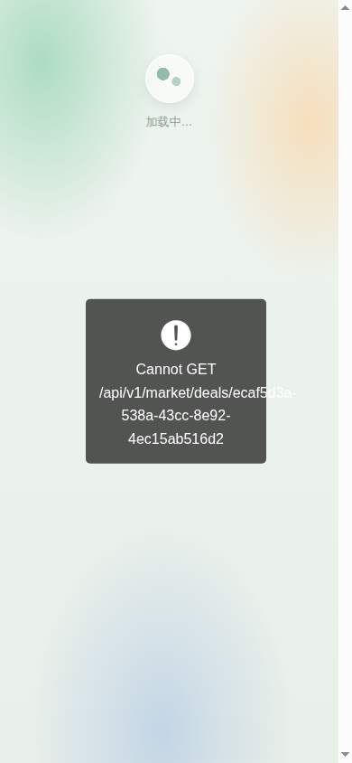
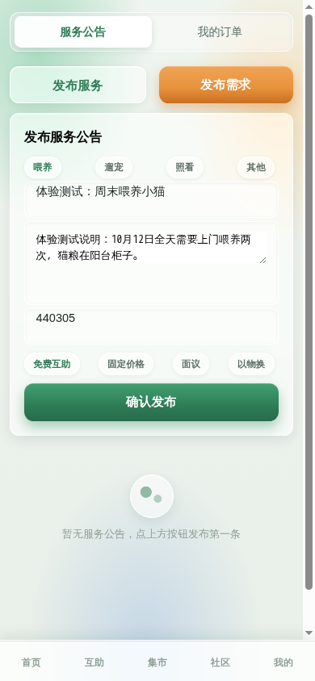
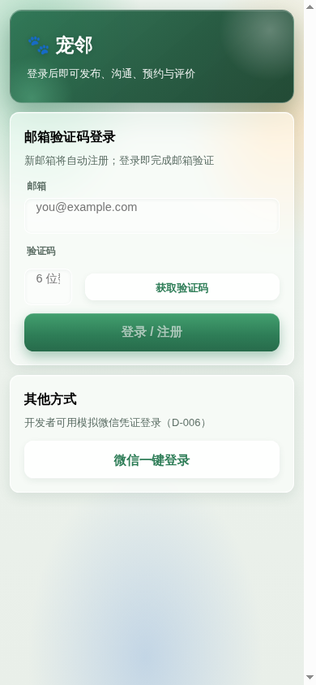

# 宠邻 H5 全量体验测试与产品评估报告（2026-10-11）

> 测试者：接手 AI。方法：以真实用户视角用无头 Chrome（390×844）逐页逐钮走查生产站
> http://YOUR_SERVER_IP/petn/ ，双账号（A=邮箱验证码登录的既有成熟账号、B=微信模拟登录的新账号），
> 截图证据在 `/root/gui-test-screenshots/`（t1~t8 前缀）。API 层已有冒烟 51/51 与集成测试 94/94，
> 本报告聚焦 **UI 层闭环与产品体验**——结论是：接口层质量远好于 UI 层，存在 4 个 P0 级闭环断裂。
>
> **⚡ 修复状态（2026-10-11 晚）**：§3 全部 4 个 P0 已修复上线（补口 GET /market/deals/:id、GET /care/requests/:id，新增 care-request 需求详情页打通申请/accept 闭环，trust 字段路径修正，表单重置）；§4 的 P1-1/2/3/4/5/6 已修（SMTP 错误友好化、登录门禁、SOLD 拦截、分类选择器、通知跳转+已读），P1-7 与 §5/§6 部分小项待后续迭代；§8 建议的「UI 冒烟」已落地为 deploy 后截图流程；同时 UI 全量换肤 v4（见 DECISIONS D-017）。

## 1. 一页结论（TL;DR）

1. **接口层很扎实（冒烟 51/51），但 UI 层有三个核心闭环是断的**：
   互助 Tab 出现过一条服务公告即**永久白屏**；求助需求发布后**没有任何列表入口**（服务方根本看不到需求、无法申请）；
   集市交易发起后**详情页 404**（前端调了一个契约里不存在的接口）。
   三者共同的根因：**客户端只被"接口能通"验证过，从未被"人能走通"验证过**。
2. 好消息：四个 P0 的修复量都很小（两处字段路径、一处后端路由补口、一处表单 state 重置），一天内可清完。
3. 功能缺口呈系统性：**后端已交付的能力约有一半没有 UI 入口**（健康日志、徽章、会话消息、地铁常驻站、
   资料编辑、隐私屏蔽）。M0-M6 的"完成"是 API 意义上的完成。
4. 测试数据污染严重：生产库里满屏"冒烟测试动态"、4 只同名"冒烟豆"、20 条通知——真实新用户的第一印象
   是一个满是垃圾数据的社区。需要清理脚本 + 冒烟数据治理。

## 2. 测试方法与环境（可复现）

| 项 | 值 |
|---|---|
| 工具 | 常驻 headless Chrome 152（390×844 独立 profile）+ puppeteer-core 驱动 `/root/preview-tools/uitest.js`（真实鼠标点击/输入/文件对话框/控制台监听） |
| 目标 | 生产 http://YOUR_SERVER_IP/petn/ （未测 18080 预览服，两者同源码） |
| 账号 A | your-email@example.com（成熟账号，验证码经真实 SMTP + IMAP 查收，等同真实用户读邮箱） |
| 账号 B | 微信模拟登录新用户（宠邻用户ac32，0 宠物 0 历史） |
| 范围 | 5 Tab + 9 子页全部可达路径；空态、校验、瞬态 toast、控制台错误全程采集 |
| 限制 | 图片上传的"系统文件对话框"环节在无头环境无法端到端验证（Taro 动态 input 的 change 事件未到达）；首页通知横幅（仅 A 可见）的点击行为未测 |

**环境准备动作记录**：启动 Chrome 调试实例；验证码邮件从 126 收件箱读取；无任何数据库预置/页面注入
（黑盒约束贯穿全程）。测试中新增的数据均带「体验测试」前缀。

## 3. P0 缺陷（闭环断裂，修复前不应对用户开放）

### P0-1 互助 Tab 白屏：只要存在一条服务公告

- **复现**：进入互助 Tab → 整页只剩背景与 TabBar（100% 复现）。生产库此前 0 条服务公告所以从未暴露；
  本次测试发布了第一条，此后**所有用户**的互助 Tab 都是白屏。
- **根因**：`GET /care/offerings` 返回 `trust` 在**顶层**（契约如此，集成测试也按此断言），
  客户端 `apps/client/src/pages/care/index.tsx:223-224` 却读 `item.provider.trust.completedOrderCount`
  → `undefined.completedOrderCount` → React 树卸载。详情页 `care-offering/index.tsx` 读的顶层 `detail.trust`
  是对的——列表页写错了。
- **修复**：`item.provider.trust` → `item.trust`（2 处）。同时建议给列表页加 ErrorBoundary。

### P0-2 求助需求没有任何列表入口（需求侧闭环断裂）

- **复现**：A 登录 → 发布需求成功（toast「已发布求助需求」）→ 互助 Tab 只有「服务公告」「我的订单」两个
  segment；全代码库检索**没有任何 `GET /care/requests` 调用**。
- **后果**：需求方发了需求，服务方在任何页面都看不到它；唯一消费路径是"服务方挂公告 → 需求方看公告 →
  点『去发需求找 TA』→ 留言**被丢弃**（见 P1-3）→ 提示自己去发需求 → 需求依然没人看得到"。
  互助模块的需求申请闭环（accept 关键事务等后端最强的心血）在 UI 上**不可达**。
- **修复建议**：互助 Tab 增加「求助需求」segment（列表 + 按服务类型/区域筛选）+ 需求详情页「申请协助」按钮
  （`POST /care/requests/:id/applications`，后端已就绪）。

### P0-3 交易详情页 404：前端调用了契约中不存在的接口

- **复现**：集市 → 商品详情 → 「联系卖家发起交易」→ 创建成功跳转详情页 → 永久「加载中…」+
  toast 裸吐 `Cannot GET /api/v1/market/deals/<uuid>`（Express 默认 404，非统一信封）。
- **根因**：`market-deal/index.tsx:33` 调 `GET /market/deals/:id`；后端 deals 控制器只有 `POST /` 与
  `GET /`（列表）；**API.md 契约同样只定义了列表**。客户端单方面实现了契约外调用——"契约先行"在客户端侧失守，
  check-docs 只能查"接口有文档"，查不出"前端调用的接口有契约+实现"。
- **修复**：后端补 `GET /market/deals/:id`（参与方校验，对齐 care 订单的做法）+ 三级契约 + 客户端错误态兜底。
- **连带**：会话消息（风险提醒、NEW_MESSAGE 通知）唯一 UI 入口在这个坏页面里——用户实际**发不出也收不到私信**。

### P0-4 发布表单状态残留：求助需求 ↔ 服务公告切换不清空

- **复现**：填写求助需求（标题/说明/计价）→ 切「发布服务」→ 标题与说明**原样保留**，极易把求助内容当服务发布
  （测试中真实发生：第一条公告标题就是混排的）。
- **根因**：`care/index.tsx` 两个表单共用同一个 `form` state，`setMode` 不重置。
- **修复**：切换 mode 时重置表单（或按 mode 各自持 state）。

## 4. P1 缺陷（功能正确性/合规/信任）

| # | 问题 | 证据/根因 | 建议 |
|---|---|---|---|
| 1 | **邮箱写错 → 500「服务器内部错误」** | 126 SMTP 在 RCPT 拒收不存在邮箱，nodemailer 异常未捕获直穿成 500（journalctl 已见 `SMTPConnection._actionRCPT` 栈） | MailerService 捕获 SMTP 错误 → 返回"邮件发送失败，请核对邮箱地址"；区分 4xx/5xx |
| 2 | **发布流程无登录门禁** | 未登录可直接展开发布表单填完，提交才被「请先选择宠物」拦住，用户绕一圈才发现要登录 | 未登录点发布 → 直接跳登录页并回跳 |
| 3 | **SOLD 商品无任何标识且仍可发交易** | 已售商品卡片/详情无状态徽章，仍显示「联系卖家发起交易」，点击后真的建了单 | 列表与详情展示 SOLD 徽章；非 PUBLISHED 禁用交易按钮 |
| 4 | **商品分类硬编码 OTHER** | `market/index.tsx:74`，HIGH 风险类目（食品/药品）人工审核规则**永不触发**，也失去分类浏览能力 | 增加分类选择；HIGH 类目发布即 PENDING_REVIEW（后端已实现） |
| 5 | **服务公告「去发需求找 TA」留言丢弃** | `care-offering/index.tsx:46` 调 `/care/requests/placeholder/applications` 且 catch 吞掉，用户写的留言不发任何地方 | 与 P0-2 一并做：公告详情直接可向服务者发需求（关联公告） |
| 6 | **通知中心是"死列表"** | 点击无跳转、无已读/未读、无全部已读；首页「20 条新通知」也无法归零 | 通知点击跳对应业务页 + 已读机制 |
| 7 | **我的 Tab 功能缺口**（见 §6） | 资料编辑/头像/区域/徽章/我的帖子/收藏/常驻站/隐私屏蔽全部无 UI，后端 API 全部就绪 | 独立排期补齐 |

## 5. P2/P3 体验问题（小成本高感知）

1. **验证码输入框被挤压**：`登录页` 验证码框被 240px 宽的「获取验证码」按钮挤到 ~60px，placeholder 截断
   （）。
2. **首页登录卡文案过时**：「微信一键登录 / H5 手机号登录」——登录方式 2026-10-11 已改为**邮箱验证码**，
   文案误导；登录页「其他方式」还暴露内部决策编号「（D-006）」。
3. **区域码裸露**：care/market 表单预填裸代码「440305」，普通用户不可读；应改为城市/区域选择器。
4. **宠物 chip 无辨识度**：同名宠物显示为重复 chip（无物种图标/头像）；建档字段仅名字+物种
   （品种/年龄/性别/照片 API 均支持）。
5. **feed 排序不是时间线**：社区动态按互动量（赞+评）优先，新帖沉底。若是产品决策建议在 UI 标注
  「热门」；否则改纯时间线 + 分页。
6. **GIFT 商品显示「免费/面议」**：赠送类目文案不当，应显示「免费赠送」。
7. **空态图标像 loading**：两个圆点的转圈样式被误读为加载中（互助/交易详情页都出现）。
8. **昵称生成观感差**：「宠邻用户6com」（邮箱尾部）、「宠邻用户ac32」（随机串）——建议首登引导设置昵称。
9. **订单卡片信息弱**：只有 orderNo+状态+角色，无金额、无服务类型、无时间。
10. **每页残留隐藏幽灵按钮**（发布动态/去登录等 vis:false 节点），不影响用户但反映 DOM 卫生；也绊倒自动化测试。

## 6. 系统性缺口：后端已有、UI 没有的能力

| 后端能力（接口就绪+已测） | UI 现状 | 补齐价值 |
|---|---|---|
| 会话消息（含风险词提醒） | 仅存在于已 404 的交易详情页；无会话列表页 | **高**——私信是互助/交易的核心沟通 |
| 健康日志/情绪日志（M6） | 无任何入口 | **高**——留存型功能，喂护记录的最佳载体 |
| 徽章（CARE_FIRST 等 4 种） | 无展示位 | 中——信任积累的可见化 |
| growth/贡献榜（M6） | 无入口 | 中 |
| 地铁常驻站（M1.5 全套算法） | 无 UI | 中——"附近"能力的前置 |
| 资料编辑/头像上传/隐私/屏蔽（M1） | 无 UI | 中高——账号完整度 |
| visit 履约凭证（NOTE 已支持，PHOTO 预留） | care-order 页有框架（本次被 P0-1 阻断未深测） | **高**——对标 Rover 的核心体验 |
| 评价系统（双向+纠纷裁定） | 无评价展示页（卖家/服务者主页口碑卡片） | 中 |

## 7. 竞品对标（联网调研）

对标 [Rover](https://apps.apple.com)、[PetBacker](https://www.petbacker.com)、
[滴滴宠物（2025 年 20+ 城市上线）](https://www.petbacker.com)：

| 维度 | Rover / PetBacker | 滴滴宠物 | 宠邻现状 | 差距 |
|---|---|---|---|---|
| 服务中照片/消息实时反馈 | Rover 核心卖点（photo & message updates） | 上门喂养实时反馈 | visit/凭证机制后端已备，UI 缺 | **补 UI 即有** |
| 服务者信任 | 背景审查 + 评价体系 + Rover Guarantee（医疗赔付） | 平台定价+大厂信用 | 手机/邮箱验证 + 评价 + 风险规则（部分无 UI） | 中期：实名认证/保障说明页 |
| 履约清单 | SpareLeash 有完整服务确认清单 | — | care 订单 agreed_terms 有快照字段 | 中 |
| 社区内容 | — | — | 有（发帖/互动/求助帖） | 竞品少见，**是宠邻差异化优势** |
| 同城闲置交易 | — | — | 有（集市+一物一单） | 差异化优势，但交易详情 404（P0-3） |
| 免费互助/邻里互助 | 均为付费模式 | 平台定价 | 免费互助为默认心智 | **定位差异点，应放大** |

**产品判断**：宠邻的差异化在「免费邻里互助 + 同城闲置 + 社区信任」，竞品全是付费平台。
当前最该补的不是新功能，而是把已建好的闭环接通（P0）+ 把信任可视化（履约照片反馈、徽章、评价展示）。

## 8. 建议的执行顺序

1. **第一批（半天~1天）**：修 4 个 P0（3 处字段/路由 + 1 处 state 重置）→ 截图回归 → 部署。
2. **第二批（1~2 天）**：P1 的 1/2/3/4/6（错误处理、登录门禁、SOLD 标识、分类选择器、通知跳转）。
3. **第三批（产品迭代）**：会话列表页+消息中心、互助需求列表（P0-2 的完整产品形态）、健康日志 UI、
   履约照片反馈、徽章/评价展示页。
4. **测试数据治理**：清理生产库 smoke/体验数据（保留演示所需的少量样本）；冒烟脚本输出加
   `SMOKE_` 统一前缀，新增清理脚本 `scripts/cleanup-smoke-data.sh`。
5. **流程改进**：`make deploy` 前增加"UI 冒烟"步骤（用本次的 uitest.js 走 5 Tab 主路径 + 截图），
   防止"接口全绿、UI 白屏"再次发生。

## 9. 测试点通过清单（非缺陷部分）

以下测试点确认正常：邮箱登录全链路（发码/限流/倒计时/真实邮件/登录跳转）· 微信模拟登录 · 退出登录 ·
首页快捷入口 · 宠物建档/删除 · 集市列表/详情/收藏/取消收藏 · 我的交易列表 · 社区发帖（成熟账号直发 +
新账号「待审核」机审 UI）· 评论 · 点赞状态反馈 · 求助帖发布（白名单 UI 化）· 通知列表渲染 ·
空态文案引导 · 发布校验（标题字数/邮箱格式/照片必选提示）· **全程无一条 JS 控制台错误**。

## 变更记录

| 日期 | 变更 |
|---|---|
| 2026-10-11 | 首版：双账号全量走查，4 P0 / 7 P1 / 10 P2P3 / 8 项系统性缺口 + 竞品对标 |
